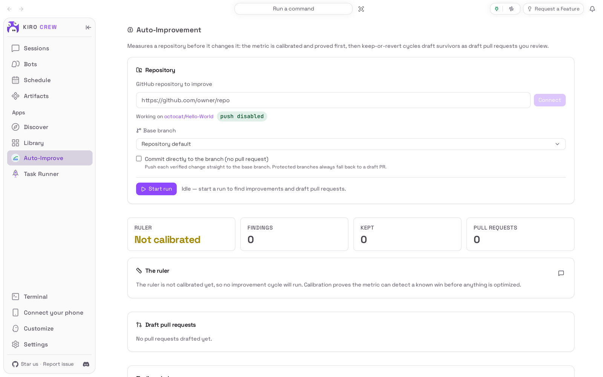
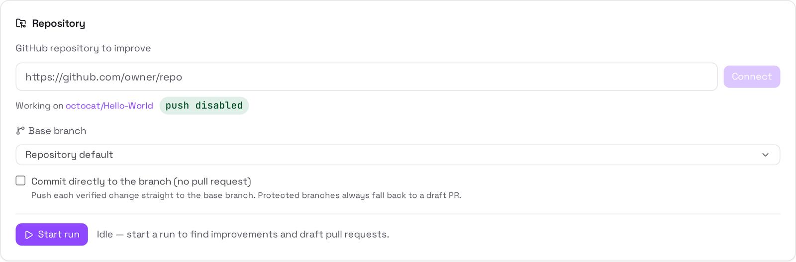
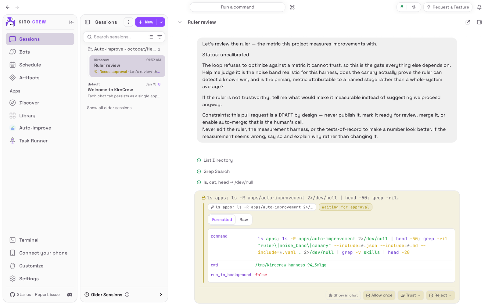

# Auto-Improvement

<picture>
  <source media="(prefers-color-scheme: dark)" srcset="docs/media/hero-dark.png">
  
</picture>

**Measures a GitHub repository before it changes it, and keeps only proven wins.**

Auto-Improvement is an app for [Kiro Crew](https://github.com/kirodotdev/KiroCrew),
the open-source personal AI agent.

## What it is

Auto-Improvement adds an **Auto-Improve** page to Kiro Crew's sidebar and two
helpers to your crew, a Scout and an Engineer. You point the page at one of your
GitHub repositories. The app first builds a way to measure it (the "ruler") and
proves the ruler can tell a real improvement from noise; then its helpers try
small fixes one at a time, test each one, and keep a change only when the
measured win is bigger than the noise. What survives becomes a **draft** pull
request on GitHub that you review and publish yourself.

**Get started:** open **Apps → Discover**, find **Auto-Improvement**, choose
**Install**, trust it, then **Enable**. See [Install](#install) for the details.

## The problem it solves

You would like an AI to make your code faster or fix its bugs, but an AI that
grades its own work tends to "improve" whatever number it is shown, and a noisy
number produces confident changes that do nothing. Auto-Improvement turns the
order around: it measures first, refuses to start on a measurement it cannot
trust, and lets plain tests and repeated measurements decide what is kept. It
never publishes or merges anything for you; it only drafts.

## Top 3 use cases

### 1. Connect a repository without letting anything escape

You want the app to work on one of your GitHub repositories, but you do not want
an AI pushing to it. You paste the repository's address into **GitHub repository
to improve** and choose **Connect**. The app makes its own copy with pushing
switched off, shows **push disabled** next to the repository's name, and lets you
choose the **Base branch** it should work from.



### 2. Ask an agent whether the ruler can be trusted

Before you let anything change your code, you want to know whether the
measurement makes sense. You choose the chat button on **The ruler** card. Kiro
Crew opens a chat called **Ruler review**, filed in an **Auto-Improve -
&lt;repository&gt;** folder, with a question about the ruler already sent. The
agent starts looking, and any command it wants to run on your computer waits for
your **Allow once** or **Reject**.


### 3. Pick up the same conversation later

You come back the next day and want to continue where you left off. You choose
the same chat button on the page again. Instead of a second, empty chat, Kiro
Crew reopens the **Ruler review** chat you already had. The same works for every
pull request and finding the app lists: each one gets one conversation.



## Watch it


[Watch the walkthrough as a video (MP4)](docs/media/walkthrough.mp4).

<sub>Recorded from a real Kiro Crew (main `55439d8770`) on a throwaway home, with
this repository installed into it. The repository shown is GitHub's own public
sample repository, octocat/Hello-World. The agent in the chat was a live AI model,
so what it does differs from run to run; the wait while it worked is shortened.
No improvement run is shown: the sample repository has no tests to measure, so its
ruler stays not calibrated and the lists of findings and pull requests are
empty.</sub>

## Install

**From the Kiro Crew App Store**

1. In Kiro Crew, open **Apps → Discover** in the left sidebar.
2. Search for **Auto-Improvement** and choose **Install**.
3. Kiro Crew asks **Trust “Auto-Improvement” to run its own code?** The app needs
   its own code to copy your repository, run its tests and measurements, and
   drive its helpers. Trusting it gives that code the same access Kiro Crew has
   (your files, your saved sign-ins and the internet), as the dialog says. Choose
   **Trust this app**. You can take it back later in **Settings → Security →
   Third-party apps**.
4. The app installs switched off. Choose **Enable** on its page. It then shows up
   as **Auto-Improve** under **Apps** in the sidebar and in **Apps → Library**.

What it needs: a Mac, Linux or Windows computer running Kiro Crew 0.13.0 or
later, where ordinary chats already work; `git` and the GitHub command-line tool
(`gh`), signed in to your GitHub account, on the same computer; and a GitHub
repository you can open pull requests against.

## First run

The page opens with an empty **Repository** card: nothing is connected, there is
no ruler, and the **Findings ledger** and **Draft pull requests** lists are empty.
Paste the address of a GitHub repository (for example
`https://github.com/your-name/your-project`) into **GitHub repository to improve**
and choose **Connect**. When the copy is ready the card says **Working on
&lt;your-name/your-project&gt;** with a **push disabled** badge. The first time the
app is turned on it also adds its two helpers to your crew, **auto-improvement-scout**
and **auto-improvement-engineer**; you can see them under **Bots**.

## How to use it

1. Open **Auto-Improve** in the sidebar.
2. Under **Repository**, paste the repository's address and choose **Connect**.
3. Choose the **Base branch** the app should start from (or leave **Repository
   default**). Leave **Commit directly to the branch (no pull request)** off unless
   you want verified changes pushed straight to that branch; a protected branch
   always falls back to a draft pull request.
4. Choose **Start run**. While it runs the card shows the cycle and what was kept,
   with a live activity feed; **Stop run** stops it between attempts.
5. Read the results: **Findings ledger** lists every candidate and what happened to
   it (open a row to see its evidence, the test that reproduced it and the
   change), and **Draft pull requests** lists the drafts with their review state
   and checks. **Commit to the branch** on a queued finding commits it after you
   confirm the branch.
6. Use the chat button on **The ruler**, on a pull request or on a finding to talk
   it over with an agent. The same button later reopens the same conversation.

A run only starts when the repository can be measured: the ruler must be
calibrated and must detect a known improvement, and the copy must still have
pushing switched off. When that is not the case **Start run** does not start a
run.

## Settings & data

- **Where your data lives:** `~/.kiro/crew/apps/auto-improvement/data/` (or under
  `$KIROCREW_HOME` if you set it): the connected repository, the ruler, the
  findings, the queued changes and the links to your chats, one set per repository
  and branch. The copies of your repository and the trial changes live in
  `~/.autoimprove-scratch/` (or the folder `AUTO_IMPROVEMENT_SCRATCH` names).
- **What leaves your computer:** the repository is copied from GitHub, and the
  draft pull requests, their status and their checks go to and from GitHub through
  your signed-in `gh`. The helpers' and chats' messages go to the AI model Kiro
  Crew uses, like any other chat. Nothing is pushed or published without a draft
  pull request you review, or your confirmation for **Commit to the branch**.
- **Turn it off:** **Apps → Library**, open the **⋯** menu on Auto-Improvement,
  choose **Disable**. A run in progress is stopped. Your data is kept.
- **Remove it:** the same menu, **Uninstall**. **Keep app data** is ticked by
  default; untick it to delete the data too. The copies in the scratch folder and
  the two helpers under **Bots** stay until you delete them.

## Troubleshooting / FAQ

**Connect shows a message instead of "Working on".**
The address must be an `https://github.com/<owner>/<repository>` address, and the
computer must be able to download it. The message under the box says what went
wrong, for example that only github.com addresses are supported.

**Start run does nothing.**
The app does not start a run it cannot measure. The ruler card says **not
calibrated yet** until the app has proved its measurement on your repository,
which needs a repository with tests or a benchmark it can run repeatedly.

**The chat button opened a different chat.**
Open **Sessions** and choose the chat in the **Auto-Improve - &lt;repository&gt;**
folder. Choosing the chat button again from the page also opens it.

**The agent in the chat is asking to run a command.**
That is Kiro Crew's normal approval step. Choose **Allow once** only if you are
happy for that command to run on your computer, or **Reject** to say no.

**A pull request shows "Unavailable".**
Kiro Crew could not read that pull request from GitHub just then. Check that `gh`
is signed in, then use the refresh button on its row.

## Development

The app is the built-in Auto-Improvement of Kiro Crew, moved into its own
repository. [PORTING.md](PORTING.md) says what changed and which Kiro Crew
internals it still needs; [docs/MANUAL.md](docs/MANUAL.md) is the operator's
manual and [docs/BUILTIN_README.md](docs/BUILTIN_README.md) the engineering
overview it shipped with. `backend/` is the in-gateway part (routes, the run
supervisor, the PR watchers, the stdio MCP server started by
`backend/mcp_launch.py`), `spine/` the improvement loop, `profiles/` the GitHub
repository profile, and `ui/` the page, built into the committed `ui/dist/index.mjs`.

### Install from a clone

```bash
git clone https://github.com/KiroCrewCaptain/kirocrew-app-auto-improvement
kirocrew app install ./kirocrew-app-auto-improvement
kirocrew app enable auto-improvement
```

`kirocrew app enable` is refused with `app_execution_denied` until the app is
trusted, and there is no command-line trust step. Enable it from **Apps →
Library** instead: that opens the trust dialog, and **Trust this app and enable**
does both. `kirocrew app disable auto-improvement` turns it off;
`kirocrew app uninstall auto-improvement` keeps the data and adding
`--purge-data` deletes it.

### Tests

```bash
python -m pip install -r tests/requirements.txt
python -m pytest -n 4 --dist loadgroup
cd ui && npm ci && npm run typecheck && npm test && npm run build
```

The Python tests run against a pinned public commit of Kiro Crew; none of them
reaches the network or starts a model. CI also checks that `ui/dist/index.mjs` is
exactly what `npm run build` produces.

### Re-capture the README media

The pictures and the recording come from a real, isolated Kiro Crew gateway
driven by [`capture/`](capture/README.md). After any change to what the app shows:

```bash
AUTO_IMPROVEMENT_SCRATCH=$(mktemp -d) python capture/capture.py --kirocrew /path/to/KiroCrew
python capture/check_readme.py
```

`AUTO_IMPROVEMENT_SCRATCH` keeps the capture's repository copy out of your own
scratch folder. Then look at every image and at a few frames of the video before
committing (see [CHECKLIST.md](CHECKLIST.md)).

## License

Apache License 2.0. See [LICENSE](LICENSE) and [NOTICE](NOTICE).
